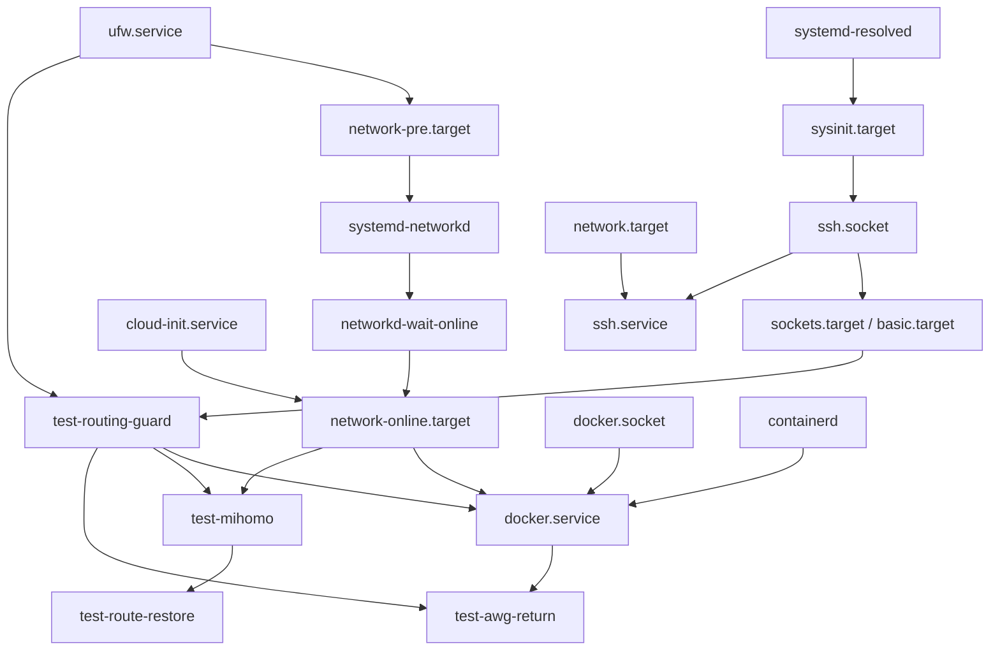

# ZAI-86 — Test reboot preflight, recovery audit and reproducibility

Audit date: 2026-10-11 (Europe/Moscow). Starting checkout and PR #11 head:
`64965bd40a2a17e5fae31f3245555157ee13b351`. PR #11 is OPEN, unmerged;
its Test/vet and linux amd64/arm64 jobs passed in
[run 38140154766](https://github.com/saymer-alt/vps-gateway-bootstrap/actions/runs/38140154766).
Main remains `1e41c29c1f35a9b092472d9b2bfc43fcbfbd0872`.
This documentation follow-up is based on PR #11, not an independent replacement
for it. Its draft PR targets main to run the existing main-targeted CI; until
PR #11 is integrated, the aggregate diff includes that prerequisite. ZAI-86
itself changes only this report and HANDOFF. Read AGENTS.md, latest HANDOFF and
ZAI-83/84/85 before this audit.

**Decision: keep the healthy Test VPS running. REBOOT_NOT_TESTED;
PROVIDER_RESCUE_NOT_CONFIRMED. An unattended reboot is blocked.**
There were no configuration, routing, firewall, container, service or package
mutations, no fault injection, and no production access. Read-only configuration
validation and healthy network probes can generate ordinary logs/cache/counters;
NONE here means no operational state changes. No new remote artifact or backup
was created, no keys rotated, no services restarted, no reboot executed.

## 1. Verified live baseline

SSH connected exclusively to `root@5.175.236.76:22` with
StrictHostKeyChecking=yes and HostKeyAlgorithms=ssh-ed25519. The established
known_hosts key matched `SHA256:2agxb8uEviNn5iNURe5QSzC7YYUHIUfNdFErH1ESpIo`.
Hostname Test and ens3 IPv4 match the owner-designated disposable target and
earlier reports. No production machine was contacted. Temporary local SSH key
was removed after the final external login; no credential was uploaded.

| Observation | Current result |
|---|---|
| OS / running kernel | Ubuntu 24.04.5 LTS / 6.8.0-106-generic |
| Boot ID | `c110bd0f-d9b8-4329-b441-cf6a447cab3e` |
| Final sample | 2026-10-11 21:12:40 Moscow; uptime 1 day 40 minutes |
| RAM / swap | 913 MiB total, 494 used, 419 available; 33/1535 MiB swap used |
| Root filesystem | 4.3/8.7 GiB used, 50%; 4.4 GiB free |
| Load | 0.00 / 0.02 / 0.00, snapshot only |
| Services | SSH/socket, UFW, resolved, Docker, guard, Mihomo and AWG-return active; no failed units |
| Route restore oneshot | Enabled; inactive after successful completion is expected |
| Mihomo | One process, PID 149566; current NRestarts=0; config validation succeeds |
| AWG | Both existing containers healthy, about 5 MiB each; server .2, client .3 |
| Healthy client | HTTP trace warp=on, exit 104.28.225.221; valid raw UDP DNS and application HTTP response |
| Host management | Fresh external SSH succeeds; getent resolves; IPv4/IPv6 defaults present |

A restart-required marker exists. **The next normal boot changes kernel**:
GRUB_DEFAULT=0, GRUB_TIMEOUT=0 and the first Ubuntu entry select
`/vmlinuz-6.8.0-146-generic` with its initrd. Running-kernel tests on 106 do not
validate 146. Both kernels remain on disk. Do not change GRUB or reboot during
the four-day pause. Automatic unattended updates are enabled, but no
Automatic-Reboot override is configured; the installed unattended-upgrade
implementation defaults that option to False. Updates can still restart
services or change packages, so this audit is not a four-day availability
guarantee. No freeze, automation or new monitoring was installed.

## 2. Effective systemd dependency graph

Inspected vendor units, loaded Requires/Wants/After/Before/PartOf, enablement,
all reported drop-ins, dependency lists and critical-chain output.
`systemd-analyze verify` for the named stack/network/SSH units exited 0 with
no diagnostics. No static cycle was found. Critical-chain timestamps from
this already-running boot include later restarts and are not proof of booting
the current unit graph.

Arrows below mean startup ordering, not health or hard requirement. The table
records activation/requirement semantics separately. Standard systemd
mount/slice/journal/shutdown edges are omitted from the drawing.



| Unit | Effective relevant edges / activation |
|---|---|
| ssh.socket | Enabled; TCP 22 v4/v6, FreeBind=yes, Before sockets.target/ssh.service; after sysinit. SSH service disabled as a boot unit is expected socket activation. |
| ssh.service | Requires ssh.socket; After network.target/auditd; no gateway dependency. Existing SSH socket/service active. |
| networkd | Enabled; After network-pre, udev, sysctl; Before network.target/wait-online; wants network.target/socket. |
| wait-online | Enabled; After networkd, Before network-online. Generated `/run/systemd/system/systemd-networkd-wait-online.service.d/10-netplan.conf` runs ens3:degraded then --any -o routable -i ens3, conditional on generated enablement. |
| network-online.target | Wants/After wait-online; After network.target/cloud-init. Wants is not a hard connectivity guarantee; remote WARP is never guaranteed by this target. |
| UFW | Enabled, DefaultDependencies=no; After local-fs, Before/Wants network-pre; persistent start invokes after.init. |
| guard | Enabled; Requires/After UFW, Before Docker/Mihomo/AWG; normal basic/sysinit dependencies, RemainAfterExit. |
| Docker | Enabled; Requires guard/docker.socket; After guard/network-online/containerd; Wants network-online/containerd/AWG-return. Sole custom drop-in `/etc/systemd/system/docker.service.d/zai84.conf`. |
| Mihomo | Enabled; Requires/After guard, After UFW/network-online, Wants network-online; binary config check, duplicate-process refusal, bounded TUN ExecStartPost, Restart=always. |
| route restore | Enabled; Wants/After Mihomo; no hard Requires on its health. Its own guarded TUN hook can fail if Mihomo failed. No automatic in-process TUN watcher. |
| AWG return | Enabled; Requires Docker/guard, After both, PartOf Docker. Start 40s, stop 15s, three starts/180s; ExecStop stops synthetic client before Docker. Does not continuously supervise container health. |
| resolved | Enabled; DefaultDependencies=no; Before sysinit/network/nss-lookup; no dependency on Mihomo/WARP. |

There are no custom drop-ins on the four Test units, SSH, UFW or resolved.
Docker socket can trigger the daemon early, but daemon startup still requires
the guard. Docker and Mihomo can start in parallel after their prerequisites;
AWG may transmit before TUN readiness and must be blocked until that route is
installed. Shutdown reverses After ordering: the AWG stop hook precedes Docker,
guard outlives its dependents, and UFW is later than guard. Guard has no rule
removal ExecStop. These are static expectations, not observed cold boot.

## 3. Fail-closed persistence assessment

Current IPv4 RPDB is exactly local priority 0, source 10.30.0.0/24 lookup 2030
priority 5000, main 32766 and default 32767. Table 2030 contains only
`default dev mitun0 scope link metric 100` and `unreachable default metric 42760`.
Main default is via 5.175.236.1/ens3; reverse client route is via
172.17.0.2/docker0. No temporary blackhole remains.

The first and only mangle/FORWARD rule drops source 10.30.0.0/24 whenever
output is not mitun0 (comment ZAI85-client-failclosed). Filter FORWARD is DROP,
but Docker's docker0 ACCEPT and the scoped UFW client allowance mean filter
policy alone is insufficient. Independent mangle DROP precedes them and NAT;
Docker MASQUERADE covers 172.17.0.0/16, not the original client subnet.
DOCKER-USER has one mitun0-to-docker0 allowance for destination 10.30.0.0/24.

UFW ENABLED=yes, IPV6=yes, MANAGE_BUILTINS=no. `/etc/ufw/after.init` is root-owned
750, retains stock content/set -e and appends the Git firewall-only hook.
Installed UFW code calls it on start and propagates failure. On a fresh boot
it installs the mangle guard before UFW completes, before network-pre and
before the hard-required guard/Docker/Mihomo. Guard rechecks it before routing.
The interface-name match does not require TUN to be up. Host OUTPUT is separate.
Ordinary UFW reload retains foreign mangle state in this inspected configuration;
ZAI-85 exercised reload. No reload/fault was repeated here. Flush-all, a separate
firewall writer, missing executable or a UFW/package change invalidates this
assessment. Strict rule validation can deliberately block the gateway at boot
if another owner adds RPDB/table state; it does not heal arbitrary conflicts.

**Missing selector is contained by the current independent rule**, not by the
unreachable default alone. This is source-scoped forwarded IPv4 protection,
not protection against spoofed sources/host processes or every packet family.
Prior ZAI-85 packet tests support it; no new leak capture or selector removal
was performed. Boot execution/race/crash persistence remains untested.

IPv4 forwarding is currently 1; persistent host sysctl/UFW files do not
explicitly enable it, so restoration relies on Docker's normal bridge setup.
rp_filter=2 is persistent in 10-network-security.conf. Confirm forwarding after
boot. Host IPv6 address/default are retained, forwarding=0, disable_ipv6=0;
Docker bridge IPv6=false and client topology is v4-only. Five accumulated
oif-mitun0 IPv6 selectors (32761..32765 → 2022) are present, more than ZAI-83's
single entry. They do not select ens3 management traffic; cause/cleanup is a
separate unproven runtime-idempotency concern, left untouched.

## 4. Docker allocation and smallest future design

Docker 29.1.3 (Ubuntu docker.io), overlayfs, systemd cgroups, live-restore=false.
Default bridge: 172.17.0.0/16, gateway .1, empty IPRange, MTU 1500, IPv6=false.
Both containers have IPAMConfig=null: **neither address is reserved**. Server
.2 is part of the synthetic client's literal endpoint and the host reverse
route. Client .3 is checked by the hook. No ports are currently published;
UFW's 31825/udp allowance does not establish an external AWG listener. This
acceptance concerns the existing same-host client.

ZAI-85 orderly restart evidence is valid for that scenario. Other allocations,
an explicitly stopped server (unless-stopped), unclean recovery or allocator
changes can still defeat readiness. The hook rejects rather than guesses;
bounded retries can leave AWG failed while Docker/SSH remain healthy. The
synthetic client restart=no is owned for start/stop by the oneshot; its separate
exit is not automatically repaired. The server is Docker-owned unless-stopped.

| Option | Assessment |
|---|---|
| Keep current ordered start | Smallest change: none. Appropriate for the pause; dynamic assumptions remain and must be checked after reboot. |
| Narrow Docker fixed-cidr / allocation order | A pool is not a per-container reservation. Changes default daemon networking and affects all default-bridge users. Not a complete fix. |
| Static IP on existing default bridge | Do not assume supported portable reservation semantics. Current IPAM has no explicit assignments; no live connect/update experiment authorized. |
| Dedicated user-defined bridge, explicit subnet + addresses outside dynamic range | Smallest documented reproducible future design that removes allocation-order reliance; requires a separately authorized network/container/config migration and full regression. |

[Docker documents](https://docs.docker.com/reference/cli/docker/network/connect/)
that specified addresses are reapplied on restart, conflicting addresses fail,
and static addresses outside --ip-range avoid dynamic allocation conflicts.
Use a non-overlapping explicit subnet and stable bridge name only after live
overlap discovery; do not reuse overlapping 172.17/16 beside docker0. A pool
reservation via --aux-address is not a substitute for assigning endpoint IPs.
[Network creation options](https://docs.docker.com/reference/cli/docker/network/create/)
and [bridge behavior](https://docs.docker.com/engine/network/drivers/bridge/)
are upstream references; no proposed network was created.

Future migration impact: change synthetic endpoint and reverse next hop,
replace docker0 matches in UFW and DOCKER-USER, update scoped hook admission,
account for Docker NAT and bridge IPv6 policy. The source/TUN independent DROP
can retain the same client subnet, but must be verified before admitting it.
Preserve AWG private/public keys, client inner addresses, WARP identity and
gVisor. Pin image digest; do not leave parallel containers using the same keys.
Rollback must restore old network bindings/config/matches and verify addresses,
not merely revert files. This is design work only; migration is prohibited now.

## 5. Configuration inventory and reproducibility

| Required component | Current evidence / reproduction source |
|---|---|
| Mihomo | `/root/zai78/mihomo`, v1.19.31 linux amd64, with_gvisor, built Go 1.26.8. Historical download: MetaCubeX release v1.19.31. Live checksum below; upstream byte identity not independently re-downloaded. |
| Runtime config | `/root/zai78/mihomo-config/config.yaml`, 0600; stack gvisor, auto-route=false, auto-detect-interface=false, dns-hijack=[], existing mitun0; loopback controller 19091/mixed listener 7891. Secret-bearing, live-only exact configuration. |
| WARP identity | `/root/warpscout-data/warpscout-account.json` 0600 under 0700; `/root/zai82/warp.conf` 0600; generated warp-h2/h3.yaml also secret. Active config contains the working WG material. Existing `.local/bin/warpscout` is a provisioning dependency, not a resident supervisor. |
| WARP transport | Literal 8.34.70.193:2408, IPv4; route get uses host main default/ens3, no DNS endpoint bootstrap. Host uplink/UDP reachability still required. |
| AWG image | Both use devopsigor/amneziawg:v3.1.20260828-1; digest below, linux amd64. Upstream public artifact; local offline copy/re-pull availability not tested. |
| AWG configs | `/root/zai78/server.conf` 0600 and client.conf 0600; read-only bind mounted to /config/amneziawg.conf. Exact private keys exist only in private live files. |
| Server parameters | Name awg-server-test; bridge; unless-stopped; privileged=false, CAP_NET_ADMIN, /dev/net/tun rwm; sysctls ip_forward=1 and src_valid_mark=1; no published ports; /bin/bash /entrypoint.sh, Cmd=null. |
| Client parameters | Name awg-client-test; bridge; restart=no; privileged=true; no explicit device/cap additions; same entrypoint and Cmd=null; no published ports. Both environments expose only PATH by name. |
| Container runtime | amneziawg-go userspace process in both containers; server forwarding/filter ACCEPT, no internal NAT. Native host AmneziaWG module is not required for this observed path. |
| systemd/hook | Four Test units, Docker drop-in, executable /usr/local/libexec/test-gateway-routes match Git byte-for-byte after LF normalization. Sources in docs/experiments/zai-84 at starting SHA. |
| Firewall persistence | Entire /etc/ufw, /etc/default/ufw, appended after.init; Git has snippet, not complete host-specific policy. Original before.rules retained. |
| DNS/network | Regular /etc/resolv.conf with 1.1.1.1 and 8.8.8.8, checksum below; mode foreign to resolved. /etc/netplan/50-cloud-init.yaml includes static v4/v6, routes and 1.1.1.1/1.0.0.1/2409:: DNS. Cloud/netplan/package ownership may regenerate state on future changes. No claim of boot persistence from file presence. |
| Kernel | Running CONFIG_TUN=y, NET_NS=y, IP_ADVANCED_ROUTER=y, IP_MULTIPLE_TABLES=y; NF_TABLES/BRIDGE modules; /dev/net/tun present. Routing/mangle/NAT/conntrack support required. Target kernel 146 not exercised. |
| Packages | systemd/resolved 255.4-1ubuntu8.17; iproute2 6.1.0-1ubuntu6.4; iptables 1.8.10-3ubuntu2 (nf_tables); UFW 0.36.2-6; netplan 1.1.2-8ubuntu1~24.04.3; openssh 9.6p1-3ubuntu13.19; docker.io 29.1.3-0ubuntu3~24.04.2; Python 3.12.3; curl/CA certificates; pgrep and util-linux/nsenter used by hooks/probes. |
| Recovery state | /root/zai85/backup and rollback.sh (0700 parent/script); original /root/zai84 rollback retired. These are live-only snapshot artifacts, not a complete rebuild backup. |

Important checksums:

```text
08787faafea19c1ab0f83fa5a1b22363b7d03ea78da18091a4c883aecaaa5979  mihomo
e4dc02f2cb47f1fa97c0e080dcf7ac1b58e8c35dc98231b452463ba11ef3ed25  active config.yaml
a0a6bf914b1c59e9ba3ff31a44f97afdc3ada7458bb5a1ebe875670000d4b60c  test-gateway-routes
5713164bd7b38c9b296f9d50914a62e063ccf9ff13f517b49337f8162e6227cc  rollback.sh
71897443051c4b02c83e7f272c785e0f5f8f20d099449ad478deeceb2510ace4  resolv.conf
devopsigor/amneziawg@sha256:a5724483479376903ebbcd21bf26924a98d76d69fdff2a03d2aeb063e43cd625
```

Git reproduces lifecycle assets and tests, but **not the complete gateway**.
Live-only identities, full runtime config, actual container admission state,
UFW/OS networking and private recovery backups are required. Root/zai78 and
its config directory are 0755, while /root itself is 0700 and active secrets
0600; do not inaccurately describe all nested directories as 0700. The server
is not privileged, correcting older blanket descriptions of both containers.

### Backup manifest and secure procedure (prepared, not executed)

Current ZAI-85 backup contains old units/drop-in/hook, UFW before.rules/after.init,
route/rule/firewall observations and a config checksum. **A checksum is not a
backup of config contents.** No complete tested off-host restore was established.
Inventory validation confirmed the files above and required backup members
exist. Off-host encrypted backup and a restore rehearsal remain prerequisites
for destructive recovery/rebuild, and should precede the reboot acceptance.

Manifest for a private owner-controlled archive (directories recursively,
relative to /; validate existence and disk/recipient first):

```text
root/zai78/mihomo
root/zai78/mihomo-config/config.yaml
root/zai78/server.conf
root/zai78/client.conf
root/warpscout-data
root/zai82/warp.conf
root/zai82/warp-h2.yaml
root/zai82/warp-h3.yaml
root/.local/bin/warpscout
etc/systemd/system/test-routing-guard.service
etc/systemd/system/test-mihomo.service
etc/systemd/system/test-route-restore.service
etc/systemd/system/test-awg-return.service
etc/systemd/system/docker.service.d
usr/local/libexec/test-gateway-routes
etc/ufw
etc/default/ufw
etc/resolv.conf
etc/netplan
etc/cloud
etc/sysctl.conf
etc/sysctl.d
etc/ssh
etc/fstab
etc/default/grub
boot/grub
root/zai85/backup
root/zai85/rollback.sh
root/zai85/probe.py
root/zai84/backup
root/zai84/rollback.sh
```

Add `/etc/docker` and `/root/.ssh/authorized_keys` only if found during fresh
inventory; absence must be recorded, not silently ignored. Preserve required
kernel/initrd packages or encrypted copies of both installed kernel/initrd
pairs, and capture fstab/mount/UUID/package versions. Capture container/network
inspect and image inspect privately (full inspect may contain secrets), as
well as enablement, sysctl, route/rule/firewall and sanitized runtime inventory.
Export the pinned Docker image separately; copying a running /var/lib/docker
directory is not a coherent image/container backup. Cache.db is optional
runtime state; do not treat a live copied SQLite cache as a consistent database.

Example on a **trusted Linux owner workstation**, after separately approving
the private backup operation and installing age there. Supply the same verified
SSH identity/options and a validated owner age recipient; no public uploads:

```sh
set -euo pipefail
umask 077
mkdir -p zai86-private
# gateway-manifest.txt is the validated relative-path list above.
ssh -i "$TEST_KEY" -o IdentitiesOnly=yes -o BatchMode=yes \
  -o StrictHostKeyChecking=yes -o HostKeyAlgorithms=ssh-ed25519 \
  root@5.175.236.76 'tar --acls --xattrs --numeric-owner -C / -cpf - -T -' \
  < gateway-manifest.txt | age -r "$OWNER_AGE_RECIPIENT" \
  -o zai86-private/gateway.tar.age
ssh -i "$TEST_KEY" -o IdentitiesOnly=yes -o BatchMode=yes \
  -o StrictHostKeyChecking=yes -o HostKeyAlgorithms=ssh-ed25519 \
  root@5.175.236.76 \
  'docker image save devopsigor/amneziawg@sha256:a5724483479376903ebbcd21bf26924a98d76d69fdff2a03d2aeb063e43cd625' \
  | age -r "$OWNER_AGE_RECIPIENT" -o zai86-private/awg-image.tar.age
sha256sum zai86-private/*.age > zai86-private/SHA256SUMS
```

Any SSH/tar/age error or changed-file warning rejects the backup; do not accept
a partial archive. Validate ciphertext hashes, decrypt/list using a private
recipient key, and restore into an isolated offline directory/container host
to verify paths, permissions, config hashes and image ID. Keep decryption keys
separately. Do not start duplicated AWG/WARP identities against the live network.
Filesystem/provider snapshot consistency is a separate owner-authorized task;
neither an off-host backup nor a snapshot was produced by ZAI-86. Full contents,
inspect data and decrypted archives must never enter Git, PRs or public outputs.

## 6. Provider rescue readiness

No provider account was opened or authenticated. Existing reports do not name
the retail provider or confirm console credentials. Public
[RIPE RDAP](https://rdap.db.ripe.net/ip/5.175.236.76) reports network NyaInfra,
range 5.175.236.0/24, CH, GHOSTNET-MNT/ORG-NA1663-RIPE; this identifies address
registration, not the seller of this VPS. Public search did not establish an
authoritative provider-console document tied to this instance. Provider name
was requested from the owner; it remains unknown at report preparation.

**PROVIDER_RESCUE_NOT_CONFIRMED.** Do not substitute generic other-provider VNC
instructions. Owner must identify the actual panel/service and verify usable
non-destructive console access, login method and the documented rescue path.
Viewing a console page without a usable login is insufficient. Activating
rescue/power controls is not authorized by this audit. A key-only SSH login
does not prove that a console password is available. No unattended reboot.

## 7. Recovery audit: new blocker

**CONFIRMED from file/control-flow inspection; not live fault-reproduced:**
retained ZAI-85 rollback is not a dependable acceptance fallback yet.

1. It disables AWG-return, sets only the synthetic client restart=no, then
   explicitly stops BOTH client and server.
2. Server policy remains unless-stopped. A manually stopped server is not
   automatically restarted by a Docker daemon restart, per
   [Docker restart-policy semantics](https://docs.docker.com/engine/containers/start-containers-automatically/).
3. Rollback restores the ZAI-84 Docker ExecStartPost, whose old hook waits up
   to 30 attempts for server .2 before succeeding.
4. It executes `systemctl restart docker` BEFORE its later `docker start
   awg-server-test`. Docker's post-start can time out/fail; set -e then exits
   before the explicit start, leaving the intended restoration incomplete.

This qualifies ZAI-85's earlier positive rollback review. Do not run either
rollback entrypoint blindly. Full rollback was already NOT TESTED. ZAI-86
does not fix or exercise it because live changes are prohibited. A separate
minimal fix should decouple restoration from the legacy post-start gate or
start the admitted server while the daemon is available before awaiting that
gate, then prove both success and command-failure behavior. Address checks and
the independent DROP must survive until healthy validation. Do not turn this
into automatic production authority or silently remove protection.

Recovery ladder for a future **separately approved** acceptance window:

- If SSH works: inspect current boot journal/routing/firewall/config/containers
  first. An unavailable WARP peer may recover without a service restart.
- If only the synthetic client exited and .2 server is verified: an explicitly
  approved `systemctl restart test-awg-return` starts the existing fixture;
  this is a mutation, not a post-boot inspection command.
- If Mihomo exhausted its limit: diagnose first; only after the cause is fixed
  and approval exists, reset-failed/start it. Strict routing conflicts are
  not solved by overwriting unknown rules.
- Wrong addresses: preserve fail-closed state and collect evidence; use an
  owner-reviewed topology/order repair, not automated IP adoption or network
  recreation. Current rollback cannot be the sole rescue plan.
- If SSH is absent: use the already verified provider console, diagnose network,
  UFW and ssh.socket before gateway repair. For a kernel boot failure, use the
  verified console/GRUB path to the retained 106 kernel or provider rescue;
  no universal keystroke/login procedure is claimed. Never reinstall/delete
  this VPS as an implicit recovery step.

## 8. Owner-controlled reboot acceptance checklist

All boxes must be satisfied in a fresh session; this document grants no reboot
permission and schedules nothing for the approximately four-day pause.

1. Owner returns and explicitly authorizes one reboot of this exact Test VPS.
   Confirm PR/deployed hashes and current healthy baseline again; other work
   or package updates invalidate stale evidence.
2. Provider and usable console/rescue login are verified; owner remains online.
   Resolve the rollback blocker and validate the chosen recovery procedure.
3. Complete encrypted off-host backup plus offline restore validation. Record
   current/target kernel, console path to retained kernel, boot ID, uptime,
   config/binary/unit hashes, service policies, rules/table/firewall and DNS.
4. Confirm one Mihomo, expected containers/addresses, forwarding=1, correct
   table pair and early DROP; healthy HTTP/WARP/UDP DNS and fresh external SSH.
   Verify ssh.socket enabled, not merely ssh.service. Confirm no rescue timers.
5. Open the verified console and keep the external controller ready. Only in
   that approved session execute exactly one `systemctl reboot`. Do not perform
   automatic repeated power cycles or retry reboot upon connection loss.
6. Allow up to five minutes for external SSH; collect failure evidence in the
   console if absent. A changed boot ID is mandatory; a disconnected/reconnected
   SSH session alone is not proof of reboot.
7. Run the read-only validation block below; allow bounded AWG/WARP handshake
   recovery (up to two minutes of probes, no restart loop). Confirm the actual
   kernel and compare preserved config/identity hashes privately.
8. Only then classify cold-boot recovery. Healthy probes alone do not prove
   failure-time leak prevention. Any new destructive fault/leak campaign needs
   its own scope; carry ZAI-85 evidence forward with its protocol limits.

## 9. Exact read-only post-reboot validation

Commands below run on the verified Test over a fresh external SSH connection;
use the same trusted host-key settings. Do not invoke the routing hook here:
even its guard mode writes live state. Commands are diagnostic, not auto-repair.

```sh
hostname
cat /proc/sys/kernel/random/boot_id
uptime
uname -r
systemctl is-enabled ssh.socket ufw docker systemd-networkd \
  systemd-resolved test-routing-guard test-mihomo test-route-restore test-awg-return
systemctl is-active ssh.socket ssh ufw docker systemd-networkd \
  systemd-resolved test-routing-guard test-mihomo test-awg-return
systemctl show test-route-restore -p Result -p ExecMainStatus -p ActiveState
systemctl --failed --no-pager
systemctl show test-mihomo -p MainPID -p NRestarts -p Result
pgrep -a -x mihomo
ip -4 rule show
ip -4 route show table 2030
ip -4 route show 10.30.0.0/24
ip -4 route get 8.34.70.193
iptables -t mangle -S FORWARD
iptables -S DOCKER-USER
ufw status verbose
sysctl net.ipv4.ip_forward net.ipv6.conf.all.forwarding
ip -6 addr show dev ens3
ip -6 route show default
ls -l /etc/resolv.conf
sha256sum /etc/resolv.conf /root/zai78/mihomo /root/zai78/mihomo-config/config.yaml
getent ahostsv4 www.cloudflare.com
docker inspect -f '{{.Name}} running={{.State.Running}} health={{.State.Health.Status}} ip={{.NetworkSettings.Networks.bridge.IPAddress}} restart={{.HostConfig.RestartPolicy.Name}}' awg-server-test awg-client-test
docker exec awg-client-test wget -q -O- -T 25 http://1.1.1.1/cdn-cgi/trace \
  | grep -E '^(ip|warp)='
# Existing local healthy-probe fixture, verified during preflight; no route writes.
pid=$(docker inspect -f '{{.State.Pid}}' awg-client-test)
nsenter -t "$pid" -n python3 /root/zai85/probe.py healthy
journalctl -b -u ufw -u test-routing-guard -u docker -u test-mihomo \
  -u test-route-restore -u test-awg-return --no-pager -n 160
```

Accept only: new boot ID; actual intended kernel; independent fresh SSH; one
Mihomo; guard active; successful inactive route oneshot; expected .2/.3 and
policies; one source selector; only the TUN/unreachable pair; one first DROP;
reverse route/allowance; host DNS/IPv6; unchanged working configuration/identity;
warp=on plus real HTTP and validated UDP DNS. A failed inspection is a failure,
not permission to weaken gates. The existing probe fixture is live-only;
include it privately in the acceptance kit or review/recreate an equivalent
raw DNS/application probe before the window.

## 10. Validation and remaining risks

Read-only live systemd verification and Mihomo -t passed; effective lifecycle
assets/rollback hashes match Git. Healthy client TCP/UDP DNS probes and final
external SSH passed, boot ID unchanged, no failed unit/new fault timer. Linux
go test/vet/build, linux amd64/arm64 builds and the existing 24 shell behavioral
tests run locally; final exact-head follow-up CI is recorded in its PR.

Unresolved: provider/account rescue, complete tested off-host backup, the
rollback control-flow defect, new-kernel boot, dynamic IP assumptions,
unattended update/service restart drift, in-process TUN recreation, independent
synthetic-client failure, accumulated IPv6 selectors, external-client and
exhaustive packet coverage. These do not justify disturbing the healthy gateway
during the pause. They block an unattended reboot and prevent any claim of
proven persistence. Production remains strictly outside this task.
